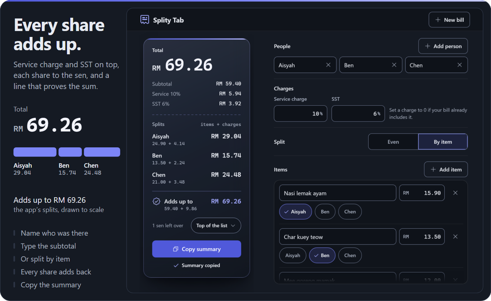
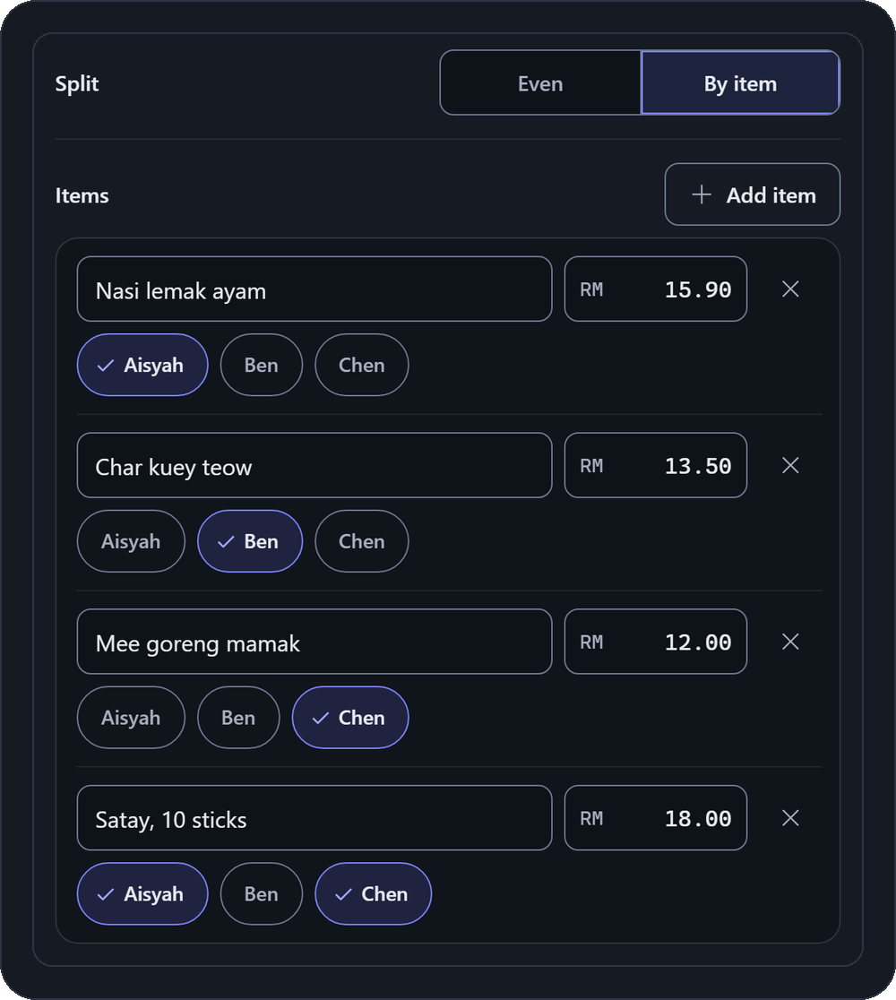
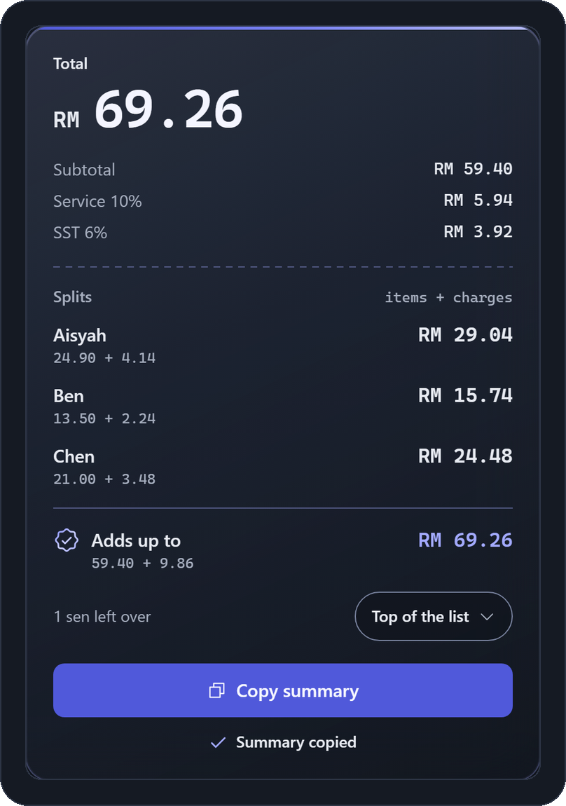
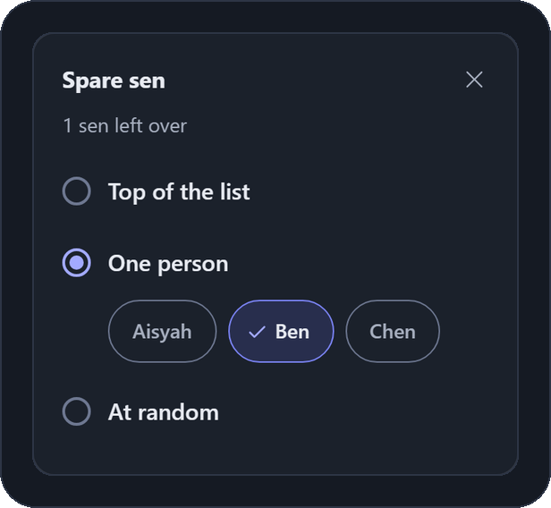
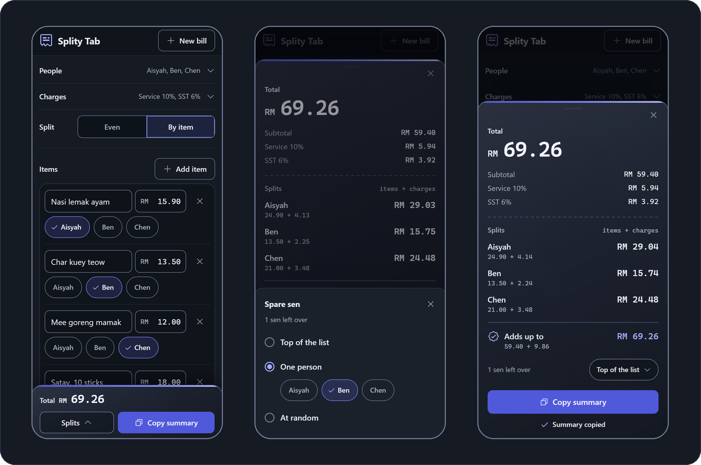

<p align="center"></p>

<h1 align="center">Danial's Splity Tab</h1>

<p align="center">Split a restaurant bill among friends down to the last sen, with every step of the maths on screen.</p>

<picture>
  <source media="(prefers-reduced-motion: reduce)" srcset="docs/readme/hero-still.png">
  
</picture>

<p align="center"><sub>Recorded from the running app in headless Chromium at 1024 x 800. Every name, price and choice was entered with mouse and key events. The panel on the left is an overlay added for the recording. The white circle marks each click.</sub></p>

<p align="center">
  <a href="https://softdevdanial.github.io/splity-tab/"></a>
  &nbsp;
  <a href="#run-it-on-your-machine"></a>
</p>

<!-- SHOWCASE_URL is a placeholder. Replace it with the address of the showcase hub once it exists, keeping each #anchor. -->
<p align="center"><sub>Made with sdlc, a multi-agent pipeline for Claude Code that I designed. <a href="SHOWCASE_URL#splity-tab">See how it was built</a>.</sub></p>

<p align="center">
  
  
  
  <a href="SHOWCASE_URL#splity-tab-tests"></a>
  <a href="SHOWCASE_URL#splity-tab-tests"></a>
</p>

## What it does

Many Malaysian restaurant bills add a 10% service charge and then 6% SST on top of it, so splitting the subtotal by hand leaves everyone short and the last few sen rarely add up.

Amounts are in Malaysian ringgit (RM), and 1 ringgit is 100 sen. SST is Malaysia's sales and service tax.

### Split evenly or by item

Type the subtotal and split it evenly. Or enter each dish and tap who had it. A shared dish is split between everyone who had it.

Works for 2 to 12 people. The service charge (10% by default) is added first, then SST (6% by default) on the new total.

<p align="center"></p>

### Shares that always add up to the total

Every share is rounded to a whole sen. The **Adds up to** line proves the shares sum to the exact total, and each share shows its working (items + charges) underneath.

**Copy summary** puts a plain-text summary on the clipboard, ready to paste into the group chat.

<p align="center"></p>

### You choose who pays the leftover sen

When a bill does not divide evenly, a few sen are left over. In **Spare sen** you choose who pays them. They can go one sen each to the people at the top of the list, all to one person you pick, or one sen each to people drawn at random, and **Pick again** makes a new draw.

<p align="center"></p>

## How the maths works

Money is held as whole sen in integers, and every split uses exact integer maths, so rounding never loses or adds a sen.

1. The service charge is worked out on the subtotal, then SST on the subtotal plus the service charge. Each is rounded half up to the sen.
2. In **Even**, the total is split into equal shares, rounded down to the sen.
3. In **By item**, each dish is split equally between the people who had it, rounded down to the sen. The service charge and SST are then shared in proportion to each person's share of the dishes, also rounded down.
4. The sen left over from rounding are given out by the **Spare sen** choice. By default they go one sen each to the people at the top of the list. That was the only rule in 1.0, so a bill saved in 1.0 keeps the same shares in 1.1.

In the bill above, the RM 9.86 of charges splits into RM 4.13, RM 2.24 and RM 3.48 by what each person ate, and the 1 sen left over goes to Aisyah, first in the list.

## On your phone

<p align="center"></p>

On screens narrower than 1024 px, **People** and **Charges** collapse to one row each, the total sits in a bar at the bottom, and **Splits** opens the shares in a bottom sheet.

<p align="center"><sub>Captured in a 390 x 844 phone layout in headless Chromium.</sub></p>

## Your data stays with you

<table>
  <tr>
    <th width="50%">No account</th>
    <th width="50%">No server</th>
  </tr>
  <tr>
    <td>Nothing to sign up for and nothing to log in to.</td>
    <td>The app is a static page, so any static host can serve it as it is.</td>
  </tr>
  <tr>
    <th>No network calls</th>
    <th>Saved in this browser only</th>
  </tr>
  <tr>
    <td>The app makes no network requests. The browser tests check that the only requests are same-origin GETs for the app's own files.</td>
    <td>The current bill is kept in <code>localStorage</code> and saved after every change, so a reload or a closed tab loses nothing. Clearing the site's data removes it.</td>
  </tr>
</table>

## What's new in 1.1

- You choose who pays the leftover sen.
- On a 360 px wide phone, the by-item list no longer scrolls sideways on a big bill.
- Holding Enter on **Remove** no longer adds a blank item.
- A warning shows when the bill cannot be saved.
- Tested in WebKit, Safari's engine, as well as Chromium.
- A new name (1.0 was called Split), a logo in the app and as the tab icon, and a new frosted-glass look chosen from five design directions.

Planned next are splitting the leftover sen among people you choose and keeping several bills at once. Both are written up in [`docs/future/`](docs/future/).

## Good to know

- The bill is lost without warning in private browsing, after Safari's 7-day limit on stored site data, or when site data is cleared. The browser gives the page no signal in any of these.
- Changes in one tab do not appear in another open tab. The last save wins.
- Any other page on the same `<user>.github.io` origin can read and change the saved bill, including my other projects there.
- On a 360 px wide phone, a price as large as 99999.99 is cut off to "99999.9" until you tap its field. The splits always show the full amount. This is a 1.1.0 trade-off that keeps the field at the design's width.
- Tested in Chromium and WebKit, Safari's engine. Firefox is not tested. Phone layouts were checked by automated tests in emulation. The manual iPhone tests were not run, so they are not counted as passed.

<details>
<summary><b>Every known limit, in full</b></summary>

Each limit below was found in testing. Its status says whether it was fixed in 1.1.0, is by design, is an accepted low risk, is planned for the next version, or comes from the browser or the host. The [showcase](SHOWCASE_URL#splity-tab) explains each call, and the records are in [`docs/`](docs/).

| Limit | Found in | Status |
|---|---|---|
| Private browsing, Safari's 7-day limit on stored site data and clearing site data lose the bill. The browser reports nothing, so no warning shows | 1.1.0 | Browser limit, the page cannot detect it |
| If storage is blocked or full, changes stay on screen but are not saved, with no message | 1.0.0 | Fixed in 1.1.0. A warning shows while saving fails |
| Two tabs of one browser editing the bill overwrite each other. The last save wins | 1.0.0 | By design |
| On a big bill (from about RM 650 of items) the by-item list is wider than a 360 px phone, so the page scrolls sideways | 1.0.0 | Fixed in 1.1.0 |
| At 360 px a price of 99999.99 shows as "99999.9" in its field until the field has focus. The splits, the bar and the sheet show every figure in full | 1.1.0 | By design for 1.1.0, a trade-off that keeps the field at the design's width |
| Any other page on the same `<user>.github.io` origin, my other projects included, can read and change the saved bill, and the page can be framed. GitHub Pages cannot set the headers that would isolate the page or stop it being framed | 1.0.0 | GitHub Pages limit |
| Holding Enter on the only item's **Remove** button adds a blank item, which one click removes | 1.0.0 | Fixed in 1.1.0. A held key now acts once |
| A double click on **Dismiss note** or on a mode label moves keyboard focus to the page. No data changes | 1.0.0 | Fixed in 1.1.0. A double click, triple click, double tap or held Enter on **Dismiss note** now acts as one press, and a double click on a mode label acts as one click |
| Only Chromium is tested | 1.0.0 | Fixed in 1.1.0, which also tests WebKit, Safari's engine |
| In Safari's engine, a tap that opens the **New bill** dialog or the **Spare sen** panel draws the keyboard focus ring on the control that takes focus. Chrome shows none, and neither does the design | 1.1.0 | Safari behaviour, not checked on a real iPhone |
| In a phone browser that highlights selected text the Android way, a selected price on the dark field can look unselected, because the app sets no selection colour | 1.1.0 | Planned for the next version |
| Two names in a right-to-left script (Arabic, Hebrew) next to each other in the People line can show in right-to-left order. The copied summary is unchanged | 1.1.0 | By design, the app is English only |
| A second tap more than 22 px from the first, or 500 ms or more after it, counts as a new press. Two deliberate taps on one spot less than 500 ms apart act once | 1.1.0 | By design |
| A hand-edited saved bill can push the id counter to its limit, and the saved bill then becomes corrupt. Only a page that can already change the saved bill can do this | 1.0.0 | Accepted, low risk |
| A name may contain zero-width or no-break space characters (U+200B, U+FEFF, U+00A0) that the app does not strip. They change only how that name looks | 1.0.0 | Accepted, low risk |
| Safari 26 shows the tab icon in one colour in both themes | 1.1.0 | Safari bug ([WebKit bug 309949](https://bugs.webkit.org/show_bug.cgi?id=309949)) |

</details>

## How it was built

Danial's Splity Tab was made with [sdlc](SHOWCASE_URL), a multi-agent pipeline for Claude Code. I designed the pipeline and every agent in it. Claude builder agents wrote the code from approved specs, separate checking agents tested and reviewed it without being allowed to fix anything, fixing agents repaired what they found, and only I can release a version. I made or approved every product decision and tested each version myself before release. The [showcase](SHOWCASE_URL#splity-tab) shows what the checking agents caught, what they missed, and where my verdict differed from theirs. The records are in [`docs/`](docs/).

Its sister app, [Danial's Streaky Habit](https://github.com/SoftDevDanial/streaky-habit), was made the same way.

## Run it on your machine

```sh
python -m http.server 8000 --bind 127.0.0.1
```

Run that from the project root, then open `http://127.0.0.1:8000/`.

Vanilla JavaScript ES modules and plain CSS. No runtime dependencies and no build step, so running the app needs only a static file server. To host it, publish only `index.html`, `src/` and a `.nojekyll` file. The repository root also holds tests, screenshots and build records that a public site should not serve.

<details>
<summary><b>Run the tests</b></summary>

```sh
node --test "tests/**/*.test.js"
python -m pytest tests/browser -q
python -m pytest tests/browser -q --engine webkit
```

The unit tests run on Node 24 (keep the glob in quotes, because a bare `node --test tests/` fails on Node 24). The browser tests need Python with pytest and Playwright. They run headless in Chromium and then WebKit, start and stop the local servers they need, and never touch the system clipboard. Screenshot comparison tests run with `python tests/browser/fidelity/run.py`. The other checks are explained in the [showcase](SHOWCASE_URL#splity-tab-tests).

At 1.1.0, 406 unit tests passed, 742 browser tests passed in Chromium, and 739 passed in WebKit with 3 skipped. Each skipped test is marked Chromium only and gives its reason.

</details>

## License

MIT, see [`LICENSE`](LICENSE).

The MIT licence covers the code and documents. It does not cover the names "Danial's Splity Tab" and "Splity Tab" or the app's logo in any form in this repository, such as [`docs/brand/`](docs/brand/) and `src/icon.svg`. They stay all rights reserved, so a copy or fork keeps the code but uses its own name and logo.
