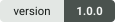
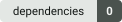
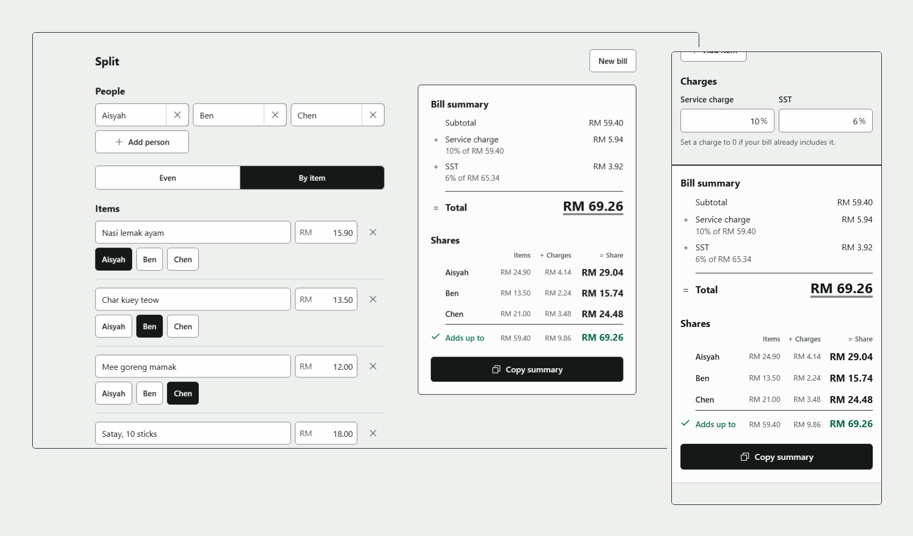
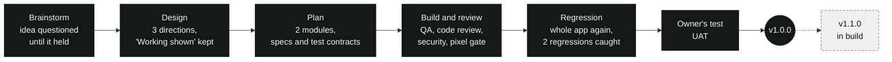

<p align="center">
  <picture>
    <source media="(prefers-color-scheme: dark)" srcset="docs/brand/lockup-dark.svg">
    
  </picture>
</p>

<p align="center">
  Share one restaurant bill between friends, and see the working.<br>
  Service charge and SST added, shares to the sen, a plain summary for the group chat. Nothing leaves your browser.
</p>

<p align="center">
  
  
  
  
</p>

<p align="center">
  
</p>
<p align="center"><sub>Real captures of the built app, taken by the pixel gate at 1280 x 800 and 390 x 844. Each one matches its approved design screen with 0 mismatched pixels.</sub></p>

## What it does

- **Who was there.** 2 to 12 people, each with a name.
- **Even or by item.** Type the subtotal and split it evenly, or type each item and tap who had it.
- **Charges on top.** Service charge, then SST on the new total, each rounded half up.
- **Shares that add up.** Every share is in whole sen, and the "Adds up to" line proves the shares come back to the Total.
- **The spare sen.** When a share does not divide to the sen, you choose who pays the spare sen. Top of the list, One person, or At random with Pick again.
- **Copy summary** puts a plain text summary on the clipboard for the group chat.
- **Your draft stays.** The bill is saved in this browser after every change, so a reload or a closed tab loses nothing. If the browser refuses to save, a note says the bill is not being saved on this device.
- **Room on a phone.** Below 1024 px People and Charges fold into one row each with a summary, the totals sit in a strip at the bottom, and Splits opens the shares in a sheet.

## How it was built

Built end to end by **sdlc**, the author's own multi-agent pipeline for Claude Code. Agents brainstorm, design, plan, build
and review. Separate finder agents test, review and audit the work and never fix it. Solver agents fix what the finders report,
and the orchestrator rules on anything in between. A person tests the result and seals each version. No agent can.



Every decision, finding and fix is dated in its version's ledger, [`docs/v1.0.0/CHANGE-LEDGER.md`](docs/v1.0.0/CHANGE-LEDGER.md)
and [`docs/v1.1.0/CHANGE-LEDGER.md`](docs/v1.1.0/CHANGE-LEDGER.md), with who made it. The table shows some of what the reviews caught on the way to 1.0.0.

| Found by | What it was | What happened |
|---|---|---|
| QA | A double tap on the dialog's Cancel could land its second tap on a toggle underneath and change the bill | One shared guard now cancels the repeat press after the dialog closes |
| Security review | A double click on Remove of the last person let the second click land on Add person, which moved up under the pointer, and add a blank person | Every Remove arms the same guard. 40 failing cases before the fix, 0 after |
| Regression code review | The Remove fix broke a double click on the right edge of Add person, which added a person and removed them again | Add person and Add item arm the guard too. 108 new test rows |
| Regression re-check | With a wrong price still typed, a double tap on a "who had it" chip could remove the whole item | A Remove now also ignores a repeat press itself. The checker's own probe went from 96 of 96 layouts failing to 0 |

## Versions

| Version | State | What changed |
|---|---|---|
| **1.0.0** | Sealed by the owner 2026-10-10, tag `v1.0.0` | First release. People, even split, by-item split, service charge and SST, copy summary, saved draft, New bill |
| **1.1.0** | In build, not sealed | You choose who pays the spare sen. The by-item table fits a 360 px phone on big bills. Holding Enter on Remove adds no blank item. A warning when the bill cannot be saved. Tested in WebKit, Safari's engine, as well as Chromium. The new logo in the app and as the tab icon, a new glass look chosen from five directions, and the name Danial's Splity Tab. Several bills written up as a future design, not built |

Each sealed version gets a `SEAL.md`, a git tag, and a read-only folder under `docs/`.

## Run it

```
python -m http.server 8000 --bind 127.0.0.1
```

Run that from the project root, then open `http://127.0.0.1:8000/`. Stop the server when you are done.
Any static host works. There is no build step and nothing to install.

## Known limits

Each was found and accepted on purpose. The reasoning is in the ledgers, `docs/modules/split-app/spec.md`
(Threat model, Residual risks) and `docs/modules/split-app/findings/security.md`.

| Limit | Since | Status |
|---|---|---|
| On a big bill (from about RM 650 of items) the by-item table is wider than a 360 px phone, so the page scrolls sideways (H-02) | 1.0.0 | fixed in 1.1.0 |
| Holding Enter on Remove of the only item adds one blank item, which one click removes (SEC-04) | 1.0.0 | fixed in 1.1.0 by the repeat guard, which also cancels a held key's repeats |
| A double click on Dismiss note or a mode label moves keyboard focus to the page. No data changes | 1.0.0 | Dismiss note fixed in 1.1.0, a double click, triple click, double tap or held Enter on it acts as one press. A double click on a mode label still acts as one click with no data change, and focus stays on the radio in Chromium and on the page in WebKit, as after one click |
| Another page on the same `github.io` origin can read the draft, and the page can be framed | 1.0.0 | kept, no way to isolate it on that host |
| Two tabs of one browser editing the bill overwrite each other, last save wins | 1.0.0 | kept, one draft per browser by design |
| A hand-edited draft can push the id counter to its ceiling, and the next save is unreadable | 1.0.0 | kept, only a page that can already overwrite the draft can do it |
| If storage is blocked or full, changes stay on screen but are not saved, with no message | 1.0.0 | 1.1.0 shows a warning while saving fails |
| Private browsing, Safari's 7-day clean-up of site data and clearing site data lose the bill, with no failure the page can see, so no warning shows | 1.1.0 | kept, the browser reports nothing the page could show |
| Safari 26 shows the tab icon in one colour in both themes (WebKit bug 309949) | 1.1.0 | kept, a Safari bug |
| A name may hold invisible characters outside the removed class (U+200B, U+FEFF, U+00A0). They change only the look of the user's own text and reorder nothing | 1.0.0 | kept |
| Two names in a right-to-left script (Arabic, Hebrew) next to each other in the People line can show in right-to-left order. The copied summary is unchanged | 1.1.0 | kept, the app is English only and isolating each name was not chosen |
| A second tap more than 22 px from the first, or 500 ms or more after it, counts as a new press. Two deliberate taps on one spot less than 500 ms apart act once | 1.1.0 | kept, the owner's ruling for the repeat guard |
| Only Chromium is tested | 1.0.0 | 1.1.0 tests Chromium and WebKit, Safari's engine. WebKit on Windows is not Safari on an iPhone, so touch, the on-screen keyboard and Safari's clean-up are checked in the owner's iPhone test. Firefox is not verified |

<details>
<summary><b>How it is built</b></summary>

Vanilla JavaScript ES modules and plain CSS. Zero dependencies, no framework, no web fonts.

**`split-core`** (`src/core/`) holds every money rule. Amounts are integer sen.
- `parseAmount`, `parseRate`, `formatMoney`, `formatAmount`, `formatRate` read and write ringgit text.
- `allocateByWeight` shares an amount by weight so the parts always add up to the whole, and is the one place that uses `BigInt`. `allocateEvenly` is no longer called by the page. The tests keep it as the reference for Top of the list.
- `billCharges` applies service charge and then SST on top, each with half-up rounding. `computeResult` builds the even split or the by-item split from the typed bill. It splits each division into floor parts (`floorParts`) and hands out the spare sen by the bill's own rule (`bill.spare`, read by `spareRule`), and returns `spare` with the result.
- `newBill`, `addPerson`, `removePerson`, `addItem`, `toggleItemPerson` and the other actions return a new bill and never change the old one. `sparePeople` lists who can take a spare sen. Every copy of a bill takes its fields from `BILL_FIELDS`, the keys of `newBill()`, so `bill.js` and `spare.js` cannot drift apart.
- `src/core/spare.js` holds the spare sen choice. `chooseSpareRule` sets Top of the list, One person or At random, `chooseSparePerson` names the one person, and `pickAgain` draws a new order with the random source it is given.
- `NAME_CONTROLS` is the one class of control, line and paragraph separator and bidi control characters, written once in `bill.js`. `plainName` returns a name with every character of that class deleted. No core action calls it, the app does.
- `summaryText` writes the copy summary, one line per row, with any character of `NAME_CONTROLS` in a name turned into a space.

**`split-app`** (`src/main.js`, `src/draft.js`, `src/errors.js`, `src/ui/`) is the page.
- `src/main.js` boots the page, keeps the one bill, and routes every change to the bill through `commit`. The caller runs a core action (for example `commit(addPerson(bill))`), and `commit` takes the bill it returned, saves the draft and calls `render`. `render` reads the view state and never writes it. `commit` clears the copy status on every change to the bill, and `copySummary` drops a clipboard answer that arrives after the bill changed. `showCopyStatus` (`src/ui/copy-status.js`) draws the status into every status paragraph, the card's, the strip's and the Splits sheet's.
- `src/draft.js` saves and loads the draft (`getStorage`, `loadDraft`, `saveDraft`, `encodeDraft`, `decodeDraft`).
- `src/errors.js` holds the rules for when a field error shows, with their own unit tests. `newErrorFlags`, `flagsFor` and `visibleErrors` build or read the flags, and `typedInto`, `leftField` and `forgetPrice` update the flags they are given.
- `src/ui/` builds the page in blocks, one `create...` factory each. Each file's header comment gives its factory's exact arguments and what it returns. Blocks write the DOM and report gestures. They never change the bill.
- `createPeopleSection` and `createChargesSection` fold People and Charges into one row each below 1024 px. `main.js` keeps the open state.
- `createNotes` shows the save warning while the latest save failed (`saveFailing`, from `saveDraft`), and the note about a draft it could not read.
- `placeModeBlocks` keeps the Subtotal block in the DOM only in Even and the Items block only in By item (`MODE_BLOCKS`). A block is put back only when it is missing, because moving the block that holds the focused field would drop its focus.
- The Items block scrolls inside its own frame. `markFrame` sets `data-up` and `data-down` so a fade shows at each edge with more items past it. It runs on the list's scroll, on a resize of the frame, and last in `render`, after every block above the frame has its new size.
- `createReceipt` draws a result into a receipt body in one of four forms, blocked, unassigned, even and by item. The card passes its ids (`CARD_IDS`). Past six even rows it sets `many` and `--rows`, which give the splits two columns. Copy summary and the status paragraph are made once and kept, so a focused Copy summary keeps its focus. `hasSplits` says whether a result has splits to copy.
- `createStrip` runs the phone strip below 1024 px. It shows the Total, or the receipt's own message when there is none (`BLOCKED_MESSAGE`, `unassignedMessage`), turns Copy summary off without splits, and draws the strip's status. Its `fit` keeps the root's `--strip-h` at the strip's real height, after every update and on a resize, so the page always leaves room above the strip. Its `focusScroll`, the page's only `focusin` listener, scrolls a control in the page that gets focus under the strip clear of it with `scrollIntoView({ block: "nearest" })`, because Safari's engine leaves a control that is already on screen where it is. The strip's own controls, the dialogs and every width from 1024 px are left alone.
- `createSheet` runs the Splits sheet on phones. Splits opens it with the card's receipt (`createReceipt` with `SHEET_IDS`), and it follows every render while open. Close, Esc and a backdrop click return focus to Splits. Widening to 1024 px closes it without moving focus.
- `createSpareLine` keeps the spare line on the card and in the sheet, with the spare chip naming the rule in effect and Pick again. `createSpareChoice` runs P1, the spare sen choice. It opens from either chip with focus on the stored rule, applies and saves a choice at once (`chooseSpareRule` in `main.js`), sits beside the card from 1024 px (`DESKTOP` in `src/ui/media.js`) and rises as a bottom sheet below that, where `makeRoom` pads the Splits sheet so the splits stay in view. Every close returns focus to the chip shown, or to Splits. Under One person, `createPicker` shows one pill per person who can take a sen (`drawPills`, in list order), and a pill applies and saves at once (`chooseSparePerson` in `main.js`). `setChecked` in `dom.js` sets a radio's checked state for both groups in P1. Under At random, `createRandWrap` adds Pick again after the At random choice (`choicesFor` places it), made once per opening so a key press keeps focus on it. Pick again in P1 and on both receipts (`createSpareLine`) calls `onPickAgain` in `main.js`, which commits `pickAgain(bill, Math.random)`. A draw saves and renders, and a Pick again that can change nothing writes nothing. `Math.random` goes only to `chooseSpareRule` and `pickAgain`.
- `closeOnBackdropClick` is the one backdrop rule for the New bill dialog, the Splits sheet and P1. A click on the backdrop closes only if the press began on the backdrop too.
- `reconcileChildren` updates lists without re-inserting a node that is already in place, so typing never loses focus.
- `plainNameField` keeps names plain as they are typed or pasted. The person and item name fields call it from their `input` listeners. It removes the class with core's `plainName`, writes the field back only when a character of the class came in, and puts the caret where the text went in.
- `onFieldLeave` holds a field's error back until a press ends, so a tap on the button below an invalid field is never lost.
- `swallowRepeatClicks` cancels the repeat press of a double click, triple click or double tap, so it never lands on a control that moved under the pointer, and while armed it also cancels a held key's repeats. It protects only the controls that arm it. Every Remove button, Add person, Add item, Dismiss note, and the New bill dialog, the Splits sheet and P1 on open and close arm it. A Remove button also ignores a repeat press itself (`isRepeatClick`), so when a price error moves the rows and the second press of a double click lands on a Remove, nothing is removed. What counts as a repeat is written once, `isRepeatPress` in `src/ui/repeat.js`, a tap less than 500 ms after the previous click and within 22 px of it included, fed by `watchPointerClicks`.
- `createDialog` runs the New bill dialog. Cancel, Esc and Start new bill close it. A click on the backdrop closes it only if the press began on the backdrop too.

**The look.** `src/system.css` is an exact byte copy of the approved design's `docs/design/system.css`. No CSS is
added or changed.

</details>

<details>
<summary><b>Test it</b></summary>

| What | Command | Evidence |
|---|---|---|
| Unit tests | `node --test "tests/**/*.test.js"` | none |
| Browser tests, Chromium | `python -m pytest tests/browser -q` | `docs/modules/split-app/qa/functional/<ts>/` (a failure screenshot, and every run's `accessible-description.txt`) |
| Browser tests, WebKit | `python -m pytest tests/browser -q --engine webkit` (tests marked `chromium_only` are skipped with a reason and counted) | the same |
| Looks right (fidelity gate) | `python tests/browser/fidelity/run.py` | `docs/modules/split-app/qa/fidelity/<ts>/` |
| Works right (live gate) | `python tests/browser/live_e2e.py --engine <chromium or webkit>`, counted per engine as a `--control seeded` run that stops red at step 1 and then a green run against one server (`--base-url`, see `CLAUDE.md`) | `docs/modules/split-app/qa/live-e2e/<ts>-<engine>/` and `<ts>-<engine>-control/` |

Node 24, Python with pytest and Playwright, headless Chromium and WebKit (the fidelity pixel gate runs in Chromium
only). Each browser command starts and stops its own local server and prints its PID and port, except the live gate
run with `--base-url`, which uses the server you started. A bare `node --test tests/` fails on Node 24, so keep the
quoted glob. The fidelity gate uses the sdlc harness. `SDLC_HARNESS` points it at another copy.

The tests never touch the system clipboard. Every browser context gets a stand-in for
`navigator.clipboard.writeText` (a recorder by default, a rejecting or missing one for the failure tests),
and no clipboard permission is ever granted.

At v1.0.0, 427 browser tests and 275 unit tests pass. During the v1.1.0 build (2026-10-16, at the module close), 406 unit
tests pass, and 742 browser tests run in each engine, all passing in Chromium and 739 passing with 3 skipped in WebKit.

</details>

<details>
<summary><b>The saved draft and security</b></summary>

One key, `split.draft` in `localStorage`, holding `{ "version": 2, "bill": ... }` (`encodeDraft`). It is saved
after every change and read once at boot. A version 1 draft saved by 1.0.0 still loads, with the spare choice Top
of the list.

`decodeDraft` treats the stored text as untrusted. It accepts a draft only when every rule D1 to D14 in
`docs/modules/split-app/spec.md` (Persistence) holds. Those rules cover the JSON shape, the version, the mode,
2 to 12 people, 0 to 50 items, unique ids, names within their length, the id counter and the spare choice
(`readSpare`). It rebuilds every person and item name with `plainName` (`readName`, D8), so a draft saved with a
control or bidi character in a name loads with that character removed. Only LF and CR still reject the draft, as
in 1.0.
It builds the bill from known fields only and never throws. A draft it cannot read gives a new bill
and a short note saying so. If storage is blocked or full, the page keeps working in memory and shows the save
warning while saving fails. Private browsing and Safari's 7-day clean-up lose the bill without any failure the page
can see, so the warning cannot show for them (Known limits).

- Names, prices and rates reach the page only as text (`textContent`, `value`, `setAttribute` on labels). `src/` contains no `innerHTML`, `eval` or similar.
- Names stay plain. A control, line or paragraph separator or bidi control character is removed from every name at the name fields and in the decoder, so a name cannot reorder the People line on screen while the copied summary stays clean.
- The page carries a strict Content Security Policy.
  ```
  default-src 'none'; script-src 'self'; style-src 'self'; img-src 'self'; base-uri 'none'; form-action 'none'
  ```
- Nothing leaves the device. `src/` has no network API, and every test run checks that the only requests are same-origin GETs for the page's own files.
- **Publish only `index.html`, `src/` and a `.nojekyll` file.** Never serve the repository root. It holds build records, screenshots, local paths and deliberate mutant copies of `src/` used to prove the tests can fail.

</details>

## Where the record lives

- [`docs/v1.0.0/CHANGE-LEDGER.md`](docs/v1.0.0/CHANGE-LEDGER.md) and [`docs/v1.1.0/CHANGE-LEDGER.md`](docs/v1.1.0/CHANGE-LEDGER.md) list every scope, decision, finding and fix, dated, with who decided.
- `docs/regression/REGRESSION.md` is the last full re-check of the whole app.
- `docs/modules/<module>/spec.md` and `qa.md` hold the requirements and the test contract.
- `docs/modules/<module>/findings/` holds each review's verdict (QA, code review, security, fidelity).
- `docs/modules/<module>/qa/` holds the evidence of every run.
- `docs/design/` holds the approved design screens. They do not change outside the design phase.
- `docs/brand/` holds the logo, the README badges and the showcase image.
